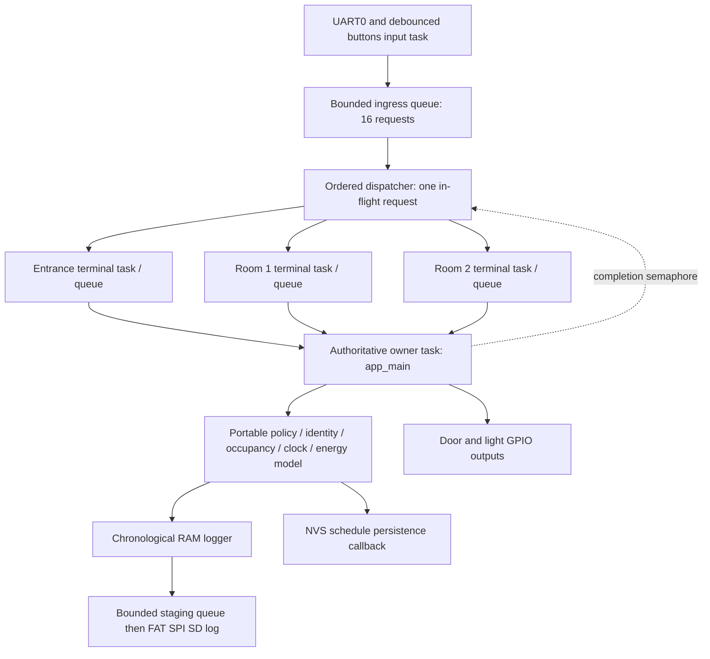

# Architecture and wiring

## Scope: three logical terminals, one ESP32

The brief requires three control terminals; a separate ESP32 per terminal is
optional. This implementation creates **three distinct FreeRTOS worker tasks**.
It does not claim to prove separate-controller or network operation. Current
official Wokwi configuration describes one firmware image; no supported
independent three-image workflow has been verified here
([discussion](https://github.com/wokwi/wokwi-features/issues/186)).

The dispatcher waits for actual owner completion before forwarding the next
request, preserving console order across different terminal workers. It does
not timeout-and-retry an already accepted event, so there is no network replay
or duplicate delivery protocol to pretend to test. Queue-full input is rejected
explicitly, not silently replayed. A stalled owner can stall dispatch; there is
no distributed fault-tolerance claim. Injecting `terminal N off` rejects that
terminal's actions in the owner, but management/status/recovery stay available.

Only the owner accesses mutable model state and output GPIOs. Workers transport
fixed-size command messages; input task owns UART framing and button debounce.
No other task mutates occupancy, authentication, SD or NVS. An extra state mutex
is unnecessary with this ownership invariant. The completion semaphore is a
local scheduling mechanism, **not** a radio ACK.

## Modules

| Source under `firmware/main/` | Responsibility |
|---|---|
| `access_control.c`, `scms.h` | Public model API, command validation, users, room transitions, simulation clock, warnings, estimated energy |
| `occupancy.c` | Building/room counters; manipulated only by model transitions |
| `scheduler.c` | Validated same-day minute intervals |
| `lighting.c` | Portable occupancy-to-light decisions |
| `logger.c` | Bounded 256×192-byte ring, chronological getters, sink callback |
| `serial_menu.c` | 128-byte UART line framing and help |
| `sync_bus.c` | Queues, three workers, dispatcher, owner completion |
| `storage.c` | FAT/SPI SD append/read, explicit volatile fallback, NVS settings |
| `main.c` | UART/GPIO/debounce, monotonic pulses, state owner, platform-only commands |

Host tests compile the actual portable sources, not copied policy code. There
is no Arduino framework and no placeholder `scms.c`.

## Invariants and time

* Each registered identity is either outside or inside, with room 0 (neither),
  1 or 2. Room membership requires inside-building state.
* Duplicate scans cannot change counts. An exit clears room membership before
  updating lights. Room counts never exceed building occupancy in model transitions.
* Both access directions obey the same `[open,close)` schedule. This unusually
  restrictive exit rule is **simulation-only and unsafe for real egress**;
  lecturer clarification is an outstanding requirement.
* Time is deterministic integer minutes/day; `advance` charges each old light
  state once, carries midnight and evaluates crossed warnings. `time` changes
  the clock without charging elapsed energy. Rewinding does not rearm a day's
  warning; changing the schedule creates a new relevant warning window.
* At 60 W, each on-minute is 60 watt-minutes = 1 Wh. Per-room estimated savings
  are always-on baseline minus actual modeled on-time; there is no physical
  energy sensor or real-time integration.
* Door/denied LEDs reset against `esp_timer_get_time()`, independent of clock
  jumps. Owner checks at ~10 ms cadence and waits for active pulses before
  blocking SD/NVS I/O or the next command. UART/debounce continue independently.

## Pin map

Board: **ESP32-WROOM DevKit / PlatformIO `esp32dev`** (not a PSRAM board reserving
GPIO16/17). Root `diagram.json` is the only diagram.

| Function | GPIO | Connection |
|---|---:|---|
| Entry door green LED | 25 | GPIO → 220Ω → LED anode; cathode → GND |
| Exit door blue LED | 26 | GPIO → 220Ω → LED anode; cathode → GND |
| Denied red LED | 27 | GPIO → 220Ω → LED anode; cathode → GND |
| Room-1 yellow light | 32 | GPIO → 220Ω → LED anode; cathode → GND |
| Room-2 yellow light | 33 | GPIO → 220Ω → LED anode; cathode → GND |
| Entry button | 13 | Input to GND on press, internal pull-up |
| Exit button | 14 | Input to GND on press, internal pull-up |
| Room-1 membership toggle | 16 | Input to GND on press, internal pull-up |
| Room-2 membership toggle | 17 | Input to GND on press, internal pull-up |
| UART TX0 / RX0 | 1 / 3 | TX0 → `$serialMonitor:RX`; RX0 ← `$serialMonitor:TX` |
| SD SCK | 18 | `sd:SCK` |
| SD MISO | 19 | `sd:DO` |
| SD MOSI | 23 | `sd:DI` |
| SD chip select | 21 | `sd:CS` |
| SD supply | 3V3 / GND | `sd:VCC` / `sd:GND` |

No button/LED uses ESP32 strapping GPIO0/2/5/12/15. Buttons require 40 ms stable
input and generate one event per press, not continuously while held. `select`
chooses their identity; both rooms reject an outside person. LEDs stand in for
door actuators and room lighting loads; buttons/serial stand in for RFID and room
occupancy sensing. These are disclosed rubric substitutions, not physical drivers.

## Storage behavior

`wokwi-microsd-card` has documented SPI support. Firmware uses
`esp_vfs_fat_sdspi_mount` without destructive auto-formatting. Each append closes
the file and checks for failure. A missing card or mount/write/read failure
produces an explicit volatile status. Logs queued during a door pulse are held
in 32 bounded slots; oldest staging records can be discarded with a warning.
The RAM model retains its own latest 256 events regardless of SD availability.
SD-failed records also enter a 32-line fallback; `storage_logs` reads at most 50
lines/chunks so a very large file cannot make a command run indefinitely.

Schedule is a versioned NVS blob committed before the new window takes effect.
Failed saves leave the old policy unchanged and are not confused with SD failure.
NVS initialization errors do not erase flash. Storage/restart behavior remains
**implemented but unverified in simulation**: see README reset/writeback caveats.
